# Streaming Hub

Zentrale Streaming-Anwendung mit Widevine-DRM-Unterstützung über Castlabs Electron. Bündelt Streaming-Dienste, Mediatheken, Live-TV und Online-Radio in einer einheitlichen Oberfläche. Der Installer unterstützt Linux x86_64 sowie macOS auf Intel- und Apple-Silicon-Macs.

## Unterstützte Dienste

### Streaming
| Dienst | URL |
|---|---|
| Netflix | https://www.netflix.com |
| YouTube | https://www.youtube.com |
| Disney+ | https://www.disneyplus.com |
| Prime Video | https://www.primevideo.com |
| Twitch | https://www.twitch.tv |
| Spotify | https://open.spotify.com |

### Mediatheken
| Dienst | URL |
|---|---|
| ARD Mediathek | https://www.ardmediathek.de/ |
| ZDF Mediathek | https://www.zdf.de/ |
| ARTE | https://www.arte.tv/de/ |

## Funktionen

- **Start-Dashboard** – Schnellzugriff auf Live-TV, Radio, Streaming-Dienste, Mediatheken und Einstellungen
- **Live-TV** – Sender-Kacheln, Favoriten, aktuell laufende Sendungen und Senderverwaltung (M3U-Quellen, Suche, Sortierung)
- **Radio** – Online-Radio mit mitgelieferter Senderliste (rund 250 deutsche Sender), eigenen Sendern per Stream-URL, Favoriten, Mini-Player und Steuerung aus dem Menüzeilensymbol; spielt auch bei geschlossenem Fenster weiter
- **Podcasts** – Sendungen über die iTunes-Suche finden, abonnieren oder per Feed-Adresse hinzufügen, mitgelieferte öffentlich-rechtliche Liste, neue Episoden, Hörstatus und Fortsetzen, Player mit Tempo und Sprüngen, Mini-Player und Steuerung aus dem Menüzeilensymbol
- **Programmführer (EPG)** – Vollbild-Programmübersicht als Liste, Raster oder „Jetzt & Gleich“, Suche, Senderauswahl, Genre-Filter, Kanalansicht mit 7 Tagen je Sender, Details mit Poster, Besetzung und weiteren Terminen, Aufnehmen, Abbrechen und Stoppen direkt in der Sendung
- **Aufnahmen** – Live-TV-Sendungen aufnehmen, auch vom Beginn der laufenden Sendung an, aus dem EPG im Voraus planen und später in der App abspielen
- **Zeitversetztes Fernsehen (Timeshift)** – Bei unterstützten Live-Streams zurückspulen und Sendungen per EPG-Marker anspringen
- **Mediathek-Suche** – ARD, ZDF und ARTE direkt aus der Programmübersicht durchsuchen
- **Bild-in-Bild** – Schwebendes Fenster für paralleles Schauen (auch TV-Streams)
- **Verlauf** – Zuletzt gesehene Inhalte mit Direktsprung
- **Streaming-DRM** – Netflix, Disney+ und Prime Video funktionieren mit Widevine
- **Gespeicherte Logins** – Du meldest dich bei jedem Dienst nur einmal an
- **Einstellungen** – Dienste, TV-Quellen, Sender, EPG, Wiedergabe, Aufnahmen, Radio und Podcasts an einem Ort
- **Backup/Restore** – Einstellungen, Dienste, TV-Quellen, Radio, Podcasts und Verlauf sichern und wiederherstellen
- **Auto-Update** – Neue Versionen direkt aus der App installieren
- **Tastaturkürzel** – für Navigation, Verlauf, Aufnahmen, Bild-in-Bild und Vollbild

## Voraussetzungen

| Voraussetzung | Unterstützung |
|---|---|
| **Node.js** | >= 22.12 |
| **npm** | Kommt mit Node.js |
| **Linux** | x86_64; Paketmanager apt, dnf, pacman oder zypper |
| **macOS** | Intel (x64) und Apple Silicon (arm64) |

## Installation

Unter Linux und macOS erkennt der Installer Betriebssystem und Architektur automatisch:

```bash
curl -fsSL https://raw.githubusercontent.com/keks-maker/streaming-hub/main/install.sh | bash
```

Unter Linux (x86_64) installiert der Installer standardmäßig das Release-Paket (`Streaming.Hub-X.Y.Z-linux-x64.tar.gz`, entpacktes App-Verzeichnis ohne AppImage) nach `~/.local/share/streaming-hub` und trägt es im Anwendungsmenü ein; Node.js wird dafür nur für die Release-Auswahl benötigt. Für eine Entwicklungs-Installation aus dem Quellcode gibt es `--source=git`. Auf Systemen, die User-Namespaces einschränken (z. B. Ubuntu 24.04), braucht die Chromium-Sandbox ein SUID-Helferprogramm; der Installer nennt in dem Fall den passenden `chown`/`chmod`-Befehl für `chrome-sandbox`. Unter macOS liegen die App-Dateien standardmäßig in `~/Library/Application Support/Streaming Hub`; das native App-Bundle für Finder und Dock wird unter `~/Applications/Streaming Hub.app` installiert. Ein abweichender Installationspfad kann über `INSTALL_DIR` gesetzt werden.

Der Installer kann Node.js unter Linux über den jeweiligen Paketmanager installieren. Auf macOS nutzt er Homebrew, falls Node.js fehlt oder zu alt ist und Homebrew bereits installiert ist.

Homebrew-Installation (https://brew.sh/):
```bash
/bin/bash -c "$(curl -fsSL https://raw.githubusercontent.com/Homebrew/install/HEAD/install.sh)"
```

Andernfalls müssen Node.js und npm vorher installiert sein. Windows wird von `install.sh` nicht unterstützt.

### Manueller macOS-Download (ZIP aus dem Browser)

Die App ist nicht notarisiert (kein Apple-Developer-Account); das Bundle ist nur
ad-hoc signiert. Wird das ZIP manuell im Browser geladen, setzt macOS das
Quarantäne-Flag und Gatekeeper blockiert den ersten Start:

- Entpacken, `Streaming Hub.app` nach `/Applications` ziehen, beim ersten Start
  Rechtsklick → **Öffnen** → **Öffnen** bestätigen (ggf. unter Systemeinstellungen →
  Datenschutz & Sicherheit → „Trotzdem öffnen“).
- Meldet macOS „Streaming Hub ist beschädigt und kann nicht geöffnet werden“,
  Quarantäne-Flag entfernen: `xattr -cr "/Applications/Streaming Hub.app"`

Installationen über den In-App-Updater oder den Installer sind nicht betroffen
(kein Quarantäne-Flag).

## Bedienung

### Startseite

Die Startseite bündelt die Bereiche Live-TV, Radio, Streaming, Mediatheken und Einstellungen; die Aufnahmen erreichst du über die Karte **Aufnahmen** im Live-TV-Dashboard. Wähle eine Kachel, um den Bereich zu öffnen.

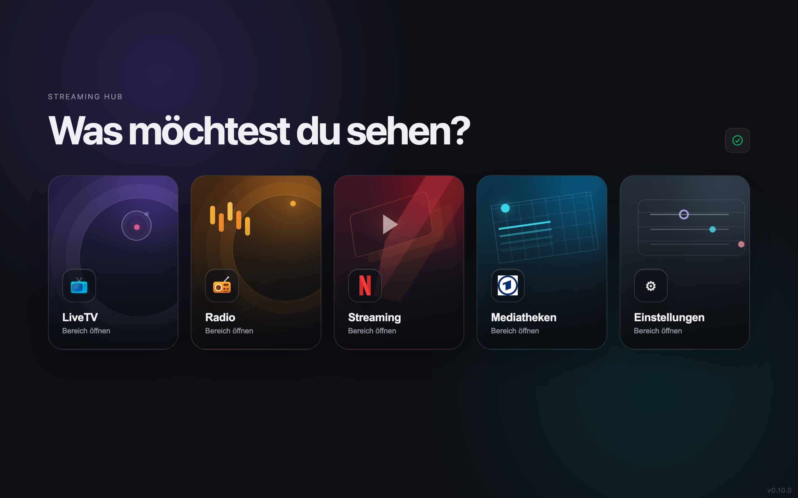

### Navigationsleiste

In den Bereichen erscheint die Navigationsleiste am oberen Bildschirmrand. Sie wechselt zwischen Live-TV, Radio, Streaming, Mediatheken und Einstellungen. Läuft eine Aufnahme, zeigt der Live-TV-Eintrag einen kleinen roten Punkt, laufende Downloads einen Ring am Mediatheken-Eintrag; den Aufnahmen-Bereich öffnest du über die Karte **Aufnahmen** im Live-TV-Dashboard.

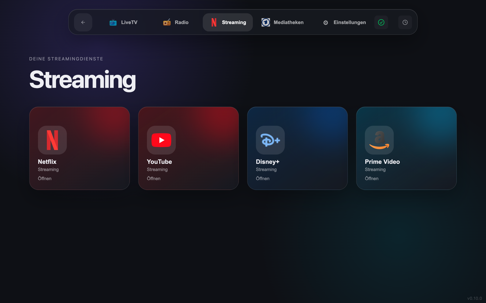

### Streaming-Dienste nutzen

Nach dem Klick auf einen Dienst wird die Webseite im Hauptbereich geladen. Deine Login-Daten und Sessions werden gespeichert – du musst dich nur einmal anmelden.

### Live-TV

#### Live-TV-Dashboard öffnen

Wähle in der Navigationsleiste **LiveTV**. Oben stehen zwei große Karten: **Programmübersicht** öffnet den Programmführer (die Statuszeile nennt den EPG-Stand und die Zahl der Favoriten), **Aufnahmen** öffnet den Aufnahmen-Bereich (die Statuszeile zeigt, wie viele Aufnahmen laufen, geplant oder fertig sind; fehlt ffmpeg, steht dort ein Hinweis). Darunter folgt eine Werkzeugleiste mit **Senderverwaltung**, **Status** und **EPG aktualisieren**, danach die Favoriten als Kacheln.

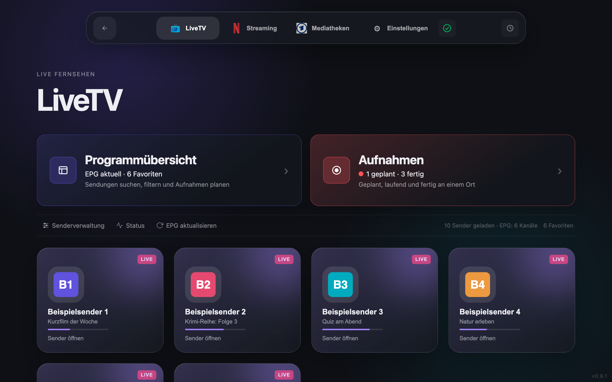

#### Sender verwalten

Die Senderverwaltung findest du unter **Einstellungen → LiveTV → Sender** (auch über **Senderverwaltung** im Live-TV-Dashboard). Sie bietet eine Suche, getrennte Ansichten für alle Sender und Favoriten sowie Sortierung und Senderbearbeitung (Name, EPG-Zuweisung, Logo, Stream-URL). Ein Hinweis zeigt, ob zu einem Sender EPG-Daten gefunden wurden.

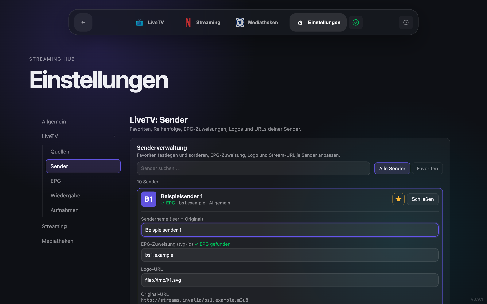

#### TV-Quellen verwalten

Öffne **Einstellungen → LiveTV → Quellen**, um TV-Quellen zu pflegen. Du kannst Quellen hinzufügen, bearbeiten und entfernen:
- **Name** – z.B. „Deutsche Sender“
- **M3U-URL** – Link zu einer M3U-Playlist (oder lokale Datei über 📁)
- **EPG-URL** (optional) – Link zu einer XMLTV-Datei für Programminformationen
- **Farbe** – Kennzeichnung der Quelle

Favoriten und Anpassungen bleiben beim Bearbeiten einer Quelle erhalten. Eine vorkonfigurierte Quelle (Deutsche Öffentlich-Rechtliche) ist bereits enthalten. Unter **LiveTV → EPG** siehst du die EPG-URL je Quelle und kannst das Programm manuell aktualisieren.

#### Sender auswählen

Klicke eine Sender-Kachel im Live-TV-Dashboard oder einen Eintrag in der Senderverwaltung an, um den Stream zu starten. Die Senderverwaltung lässt sich über **Senderverwaltung** im Live-TV-Dashboard öffnen und bietet Suche sowie Gruppen; im Programmführer wählst du über **Sender ▾** auch **Alle Sender**.

#### Favoriten

Klicke in der Senderverwaltung auf den Stern (☆), um einen Sender als Favorit zu markieren. Im Tab **Favoriten** kannst du die Favoriten separat ansehen und sortieren.

#### Favoriten sortieren

Öffne in der Senderverwaltung den Tab **Favoriten**, wähle **Reihenfolge bearbeiten** und verschiebe Sender per Drag & Drop. Die Sortierung wird gespeichert.

#### Kanalwechsel im TV-Modus

Im laufenden TV-Stream kannst du die Sender wechseln:
- **Pfeiltasten hoch/runter** – nächster/vorheriger Sender

Beim Wechsel erscheint kurz ein Kanal-Overlay mit dem aktuellen Sender und den umgebenden Kanälen (inkl. EPG-Info).

#### TV-Player Steuerung

Bewege die Maus, um die Steuerungs-Overlays einzublenden:

**Oben links:** Sendername + Logo

**Unten:** Komplette Player-Steuerung:
- **EPG-Leiste** – Aktuelle Sendung mit Uhrzeit
- **DVR-Leiste** – Sendungsmarker anklicken, zurückspulen oder mit `L` zur Live-Kante springen (bei unterstützten Streams)
- **Play/Pause** – Button oder `Leertaste` / `K`
- **Lautstärke** – Slider oder `+` / `-`
- **Stumm** – Button oder `M`
- **Audiospur** – Dropdown bei Sendern mit mehreren Tonspuren
- **Vollbild** – Button oder `F`

#### Sender bearbeiten

Unter **Einstellungen → LiveTV → Sender** verwaltest du alle Sender: Suche, Filter nach Quelle, Favoriten per Stern und Reihenfolge der Favoriten. Wähle einen Sender, um ihn anzupassen:
- **Name** – Anzeigename
- **EPG-Zuordnung** – Programmdaten (tvg-id) zuweisen, mit Auswahlliste
- **Logo-URL** – Senderlogo ersetzen, mit Vorschau
- **Stream-URL** – Stream überschreiben, mit „Auf Original zurücksetzen“

Die Änderungen werden pro TV-Quelle gespeichert und sind sofort aktiv.

#### Aufnahmen

Live-TV-Sendungen lassen sich direkt im TV-Player aufnehmen und später ansehen. Voraussetzung ist, dass die Aufnahme-Komponente (ffmpeg) verfügbar ist; ihren Status zeigt **Einstellungen → LiveTV → Aufnahmen**.

**Aufnahme starten:** Klicke im TV-Player unten auf den Aufnahme-Button (Ring mit Punkt) oder drücke `R`. Es erscheint ein Dialog mit drei Optionen:
- **Ab Bildposition starten** – Beginnt an der Stelle, die du gerade im Zeitversatz ansiehst (am Live-Bild nicht verfügbar)
- **Aktuell angezeigte Sendung aufnehmen** – Nimmt die laufende Sendung ab ihrem Anfang auf, sofern dieser noch im Zeitversatz-Fenster des Senders liegt
- **Bis zum Ende der Sendung** – Nimmt ab jetzt auf und stoppt automatisch am Sendungsende (benötigt EPG-Daten)

Nicht verfügbare Optionen sind ausgegraut; ein Hinweis nennt den Grund. Es laufen standardmäßig bis zu drei Aufnahmen gleichzeitig (je Sender eine); das Limit ist unter **Einstellungen → LiveTV → Aufnahmen → Parallele Aufnahmen** einstellbar. Wird es überschritten, fragt die App, ob du trotzdem aufnehmen möchtest.

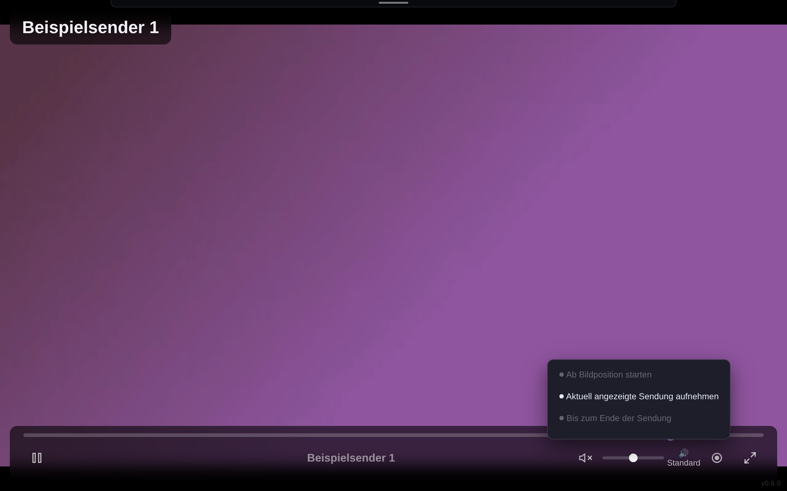

**Laufende Aufnahme:** Oben im Player zeigt ein „REC“-Hinweis mit Laufzeit, Sender und Sendung, dass aufgenommen wird – auch wenn du den Sender wechselst. Ein Klick darauf (oder auf den roten Aufnahme-Button) öffnet die Verwaltung zum Beenden. Aufnahmen laufen weiter, wenn du das Fenster schließt: Die App bleibt dann im Tray (Symbol rot bei laufender Aufnahme) und lässt sich von dort öffnen oder die Aufnahme stoppen. Reißt die Verbindung kurz ab, versucht die App automatisch, die Aufnahme fortzusetzen; nach einem Absturz werden unvollständige Aufnahmen beim nächsten Start gerettet.

**Mac aufwecken (nur macOS):** Schläft der Mac zur geplanten Startzeit, startet die Aufnahme nicht. Unter **Einstellungen → LiveTV → Aufnahmen → Aufwecken für geplante Aufnahmen** erlaubst du das Aufwecken per Klick auf **Aufwecken erlauben**; dabei fragt macOS einmal pro App-Start nach dem Administrator-Passwort. Die Erlaubnis gilt nur, solange Streaming Hub läuft (im Tray genügt), und hinterlässt nichts im System. Der Mac muss am Netzteil hängen. Aufwecken klappt nur aus dem Ruhezustand, nicht bei heruntergefahrenem oder neu gestartetem Mac (die App läuft dann nicht); ein gesperrter Bildschirm ist unkritisch. Im Bereich **Geplant** zeigt ein Hinweis, ob das Wecken aktiv ist.

**Aufnahmen ansehen:** Öffne im Live-TV-Dashboard die Karte **Aufnahmen** oder drücke `Strg` + `R`. Die Übersicht zeigt Titel, Sender, Datum, Dauer und Status jeder Aufnahme. Hier kannst du Aufnahmen abspielen und löschen. Während eine Aufnahme nach dem Beenden in das MP4-Format umgewandelt wird, siehst du den Fortschritt; fertige Aufnahmen liegen als normale MP4-Dateien im Speicherordner und lassen sich auch mit anderen Playern öffnen.

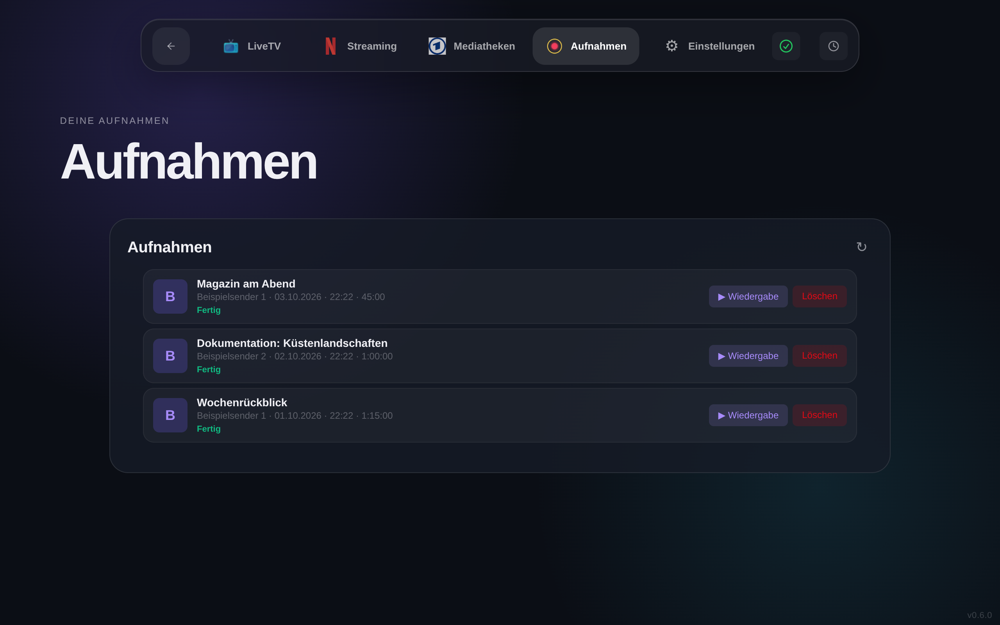

**Aufnahmen planen:** Klicke im Programmführer bei einer Sendung, die in der Zukunft liegt, auf **Aufnehmen** (in Liste, Raster, Kanalansicht oder Details). Der Planungsdialog zeigt Vor- und Nachlauf (Puffer) und warnt bei Konflikten mit dem Parallel-Limit. Geplante Aufnahmen siehst du im Tab **Geplant** der Aufnahmen-Übersicht; dort kannst du die Puffer ändern oder den Eintrag absagen. Die Aufnahme startet im Hintergrund, auch bei geschlossenem Fenster – die App muss dafür laufen (im Tray genügt). Verschiebt sich die Sendung im EPG, übernimmt die App die neuen Zeiten und weist am Eintrag darauf hin; verschwindet die Sendung aus dem EPG, wird nur gewarnt. Wurde der Start verpasst (App aus, Standby), startet die Aufnahme bei noch laufender Sendung sofort. Das Programm der nächsten Tage hält die App als Wochen-Cache vor und aktualisiert es im Hintergrund.

**Beenden und Tray:** Steht innerhalb der nächsten 24 Stunden eine Aufnahme an, fragt die App beim Schließen oder Beenden nach, ob sie im Hintergrund bleiben soll (**Im Hintergrund behalten** / **Trotzdem beenden**). Das Tray-Menü listet die nächsten geplanten Aufnahmen und bietet **Planung öffnen**. Während einer Aufnahme (und kurz vor geplanten Aufnahmen) verhindert die App ihre Suspendierung; einen schlafenden Rechner weckt sie nicht.

**Speicherort:** Standardmäßig `~/Videos/Streaming Hub`. Unter **Einstellungen → LiveTV → Aufnahmen** kannst du einen anderen Ordner wählen (auch Netzwerkpfade, mit Warnhinweis). Der Wechsel ist nur möglich, solange keine Aufnahme läuft. Dort stellst du auch den **Puffer** vor und nach der Sendung (0–30 Minuten, Standard 2 und 5), die **Reserve freier Speicher** (Standard 1 GB, Minimum 512 MB; darunter stoppt die Aufnahme kontrolliert) und den **Spätstart** ein.

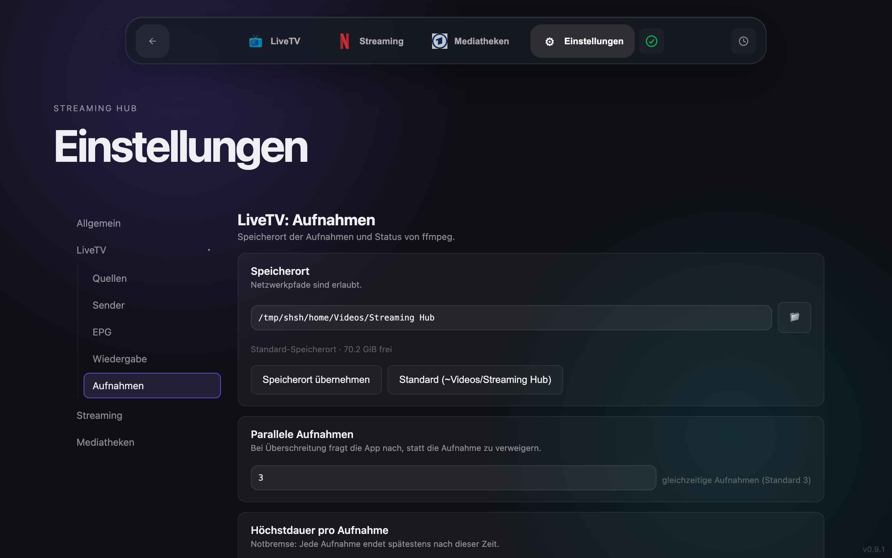

> **Hinweis:** Aufnahmen funktionieren für Live-TV-Sender aus deinen M3U-Quellen, nicht für DRM-geschützte Streaming-Dienste.

### Radio

#### Radio-Dashboard

Wähle in der Navigationsleiste oder auf der Startseite **Radio** (direkt nach Live-TV). Das Dashboard zeigt deine Favoriten als Kacheln in der gespeicherten Reihenfolge, oben stehen **Senderverwaltung**, **Liste aktualisieren** und die Zahl der Favoriten. Ein Klick auf eine Kachel startet den Sender, ein weiterer Klick pausiert ihn; die laufende Kachel zeigt einen Equalizer, bei einem Fehler steht ein Hinweis auf der Kachel. Ohne Favoriten bietet das Dashboard **Beliebte Sender hinzufügen** an (setzt einige deutsche Standardsender als Favoriten, nur auf Klick).

**Liste aktualisieren** gleicht die Stream-Adressen der mitgelieferten Sender mit dem offenen Senderverzeichnis radio-browser.info ab. Geänderte, erreichbare Adressen werden getrennt von deinen eigenen Anpassungen gemerkt; eine von dir gesetzte Stream-URL hat immer Vorrang.

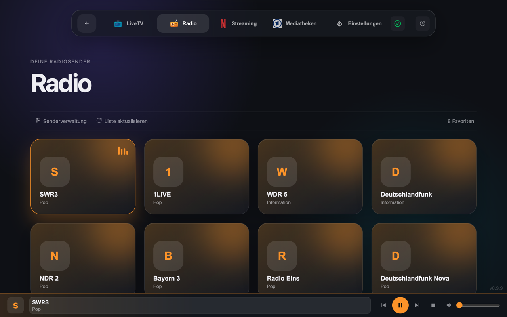

#### Mini-Player

Solange Radio läuft oder pausiert ist, zeigt eine Leiste am unteren Rand auf allen Seiten Sender und aktuellen Titel (sofern der Sender ihn liefert), **Vorheriger / Play-Pause / Nächster Favorit**, Lautstärke und **Stopp**. Im Vollbild ist sie ausgeblendet. Startest du einen LiveTV-Kanal, einen Streamingdienst oder eine Aufnahme, wird das Radio pausiert (abschaltbar) und nicht automatisch fortgesetzt.

#### Senderverwaltung

Unter **Einstellungen → Radio → Sender** (auch über **Senderverwaltung** im Dashboard) findest du die mitgelieferte Liste mit Suche (Name, Genre, Region), den Ansichten **Alle Sender** und **Favoriten**, Filtern nach Quelle, Genre und Region, Stern zum Favorisieren und Vorhören. **Reihenfolge bearbeiten** im Favoriten-Tab sortiert per Drag & Drop oder ▲▼; die Reihenfolge gilt auch im Dashboard und im Menüzeilensymbol. Mit **Bearbeiten** passt du Name, Logo-URL und Stream-URL eines mitgelieferten Senders an und setzt sie mit „Auf Original zurücksetzen“ zurück. Ein Favorit, der bei einem Update aus der mitgelieferten Liste verschwindet, bleibt erhalten und wird als „nicht mehr in der Liste“ markiert.

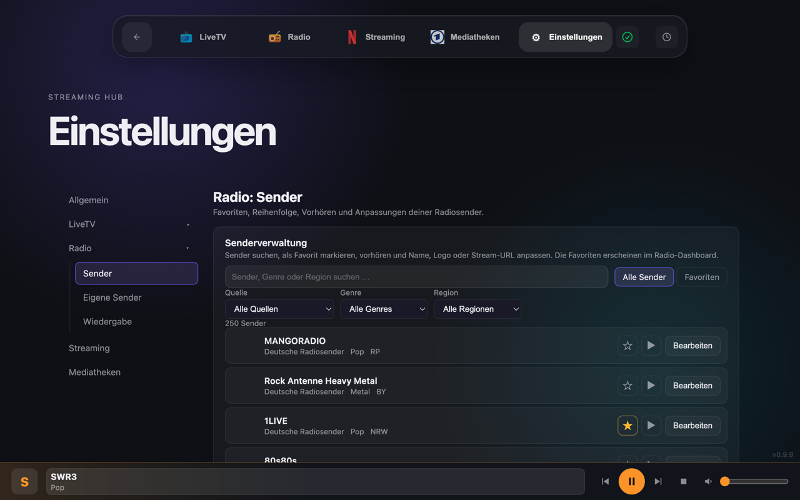

#### Eigene Sender

Unter **Einstellungen → Radio → Eigene Sender** legst du Sender per Stream-URL an (Name und URL sind Pflicht, optional Webseite, Logo-URL und Genre). Erlaubt sind http- und https-Adressen, auch im lokalen Netz; Playlists (`.pls`, `.m3u`, `.asx`) und HLS (`.m3u8`) werden aufgelöst. **Stream prüfen** testet die Adresse vor dem Speichern und zeigt, ob sie erreichbar ist, welches Format sie liefert und welche Bitrate gemeldet wird; bei einem Fehler steht der Grund dabei. Meldet der Sender im Stream seine Webseite (ICY-Header `icy-url`), trägst du sie nicht selbst ein: Das Feld **Webseite** wird dann vorbefüllt. Aus der Webseite schlägt die App ein Logo vor (Icon der Seite, sonst der Google-Favicon-Dienst; es wird nur der Link gespeichert). Das geschieht nach **Stream prüfen** und mit **Logo suchen** neben dem Logo-Feld; ohne Webseite erscheint der Hinweis „Webseite eintragen, um ein Logo zu finden“. Ein selbst eingetragenes Logo bleibt unangetastet, das Speichern ist nie blockiert.

#### Steuerung aus dem Menüzeilensymbol

Das Menüzeilensymbol (Tray) enthält einen Abschnitt **Radio**: oben die Statuszeile (Sender und Titel) mit **Pause / Fortsetzen / Abspielen** und **Stopp**, darunter deine Favoriten direkt als Liste (aktiver Sender mit Häkchen, mit dem Senderlogo, in derselben Reihenfolge wie im Radio-Dashboard; ab dem 13. unter **Weitere Favoriten**), bei mehreren Favoriten **Nächster / Vorheriger Favorit**, das Untermenü **Lautstärke** (Stumm, Lauter, Leiser) und **Radio-Dashboard öffnen**. Während Radio spielt, zeigt das Symbol ein eigenes Radio-Zeichen (eine laufende Aufnahme hat Vorrang und zeigt das rote Symbol). Unter macOS steht der Sender (auf Wunsch mit Titel) rechts neben dem Symbol, im flüssigen Modus als eigener Menüleisteneintrag mit der Farbe des Menüleistentextes (Hell, Dunkel, getönte Leiste), der nur erscheint, solange Radio spielt oder pausiert ist; unter **Einstellungen → Radio → Wiedergabe → Anzeige neben dem Symbol** wählst du **Nur Sender**, **Sender und Titel** (Standard) oder **Aus**. Ist der Text länger als 28 Zeichen, läuft er langsam durch (kurze Pause am Anfang und Ende); mit **Lange Texte durchlaufen lassen** schaltest du das ab, dann wird er mit „…“ gekürzt. Unter **Durchlauf** wählst du **Flüssig** (Standard, pixelweise) oder **Schrittweise** (zeichenweise, wirkt unruhiger; Rückfall, falls das Textbild nicht erzeugt werden kann). Ist in macOS „Bewegung reduzieren“ aktiv, läuft nichts durch. Bei laufender Aufnahme bleibt der Radiotext sichtbar. Unter Linux hängt der Funktionsumfang des Tray-Menüs vom Desktop ab; Logos im Menü gibt es dort nicht.

#### Weiterspielen bei geschlossenem Fenster

Schließt du das Hauptfenster, während Radio läuft oder pausiert ist, bleibt die App im Menüzeilensymbol aktiv und spielt weiter. Mit **Radio stoppen** (ohne offenes Fenster) oder **Beenden** endet die App. Das Verhalten lässt sich in den Einstellungen abschalten.

#### Radio-Einstellungen

Unter **Einstellungen → Radio → Wiedergabe**:
- **Lautstärke** – bleibt für den nächsten Start gespeichert
- **Beim Start letzten Sender fortsetzen** – spielt beim App-Start den zuletzt gehörten Sender (Standard: aus)
- **Radio pausieren, wenn LiveTV, ein Streamingdienst oder eine Aufnahme startet** (Standard: an)
- **Beim Schließen des Fensters weiterspielen** (Standard: an; benötigt das Menüzeilensymbol)

Favoriten, Reihenfolge, Anpassungen und eigene Sender bleiben bei Updates erhalten und sind Teil von Backup & Restore.

### Podcasts

#### Podcast-Dashboard

Wähle in der Navigationsleiste oder auf der Startseite **Podcasts** (nach Radio; grüne Akzentfarbe). Das Dashboard ist zweigeteilt: Links stehen die abonnierten Podcasts mit Cover, Name und Zahl der **neuen Episoden** (ungehört und höchstens 30 Tage alt, oder begonnen; dieselbe Zahl gilt in Statuszeile und Listen), der erste Eintrag **Alle neuen Episoden** ist vorgewählt. Rechts steht die Episodenliste der Auswahl: bei „Alle neuen Episoden“ die gemeinsame Liste der neuen Episoden, bei einem Podcast alle seine zwischengespeicherten Episoden mit der Kopfzeile „2 neue · 35 Episoden“ und „Neu“-Marke, umschaltbar auf **Nur neue**; ab 50 Zeilen lädt „Mehr laden“ weitere. Der Eintrag, aus dem gerade abgespielt wird, trägt einen Equalizer in Orange (getrennt von der grünen Auswahl). Die Sortierung (neueste, älteste zuerst, Titel A–Z) gilt auch auf der Sendungsseite; Auswahl und Sortierung bleiben beim Wechsel erhalten. Die Pfeiltasten wechseln in der Abo-Liste den Eintrag; **Sendung öffnen** (oder Doppelklick auf den Eintrag) zeigt die Sendungsseite. In schmalen Fenstern stehen beide Spalten untereinander. Ohne Abos bietet das Dashboard Suche und die mitgelieferte Liste an.

#### Episoden, Shownotes und Kapitel

Ein Klick auf eine Episode öffnet ein Fenster mit Cover, Titel, Sendung, Datum, Dauer, Fortschritt, **Abspielen/Pausieren**, **Als gehört markieren** und den **Shownotes** so, wie der Ersteller sie angelegt hat: Überschriften, Listen, Tabellen, Zitate, Code, Hervorhebungen, **anklickbare Links** und Bilder. Ein Klick auf einen Link öffnet ihn im Standardbrowser (E-Mail-Adressen im Mailprogramm), die Adresse steht als Hinweis am Link. Die App stellt keine Feed-Seite dar: Der Main bereinigt das HTML zu einem Baum aus erlaubten Elementen (kein Skript, Stil, Formular, Frame oder fremdes Attribut; Links nur http, https und mailto), und die Oberfläche baut daraus die Anzeige ohne HTML-Zeichenkette. Bilder lädt nur der Main (nur Bilder der Episode, höchstens 20 je Fenster, bis 2 MB, geprüftes Ziel); abschaltbar unter Einstellungen → Podcasts → Wiedergabe → „Bilder in Shownotes laden“ (dann bleibt der Alt-Text). Esc schließt das Fenster. Die Wiedergabe startet über den Play-Knopf der Zeile oder des Fensters, nicht durch den bloßen Klick. Liefert der Feed **Kapitelmarken** (Podcasting-2.0-JSON `podcast:chapters` oder Podlove `psc:chapters`), zeigt das Fenster die Kapitelliste; ein Klick springt dorthin, und der Mini-Player nennt das aktuelle Kapitel. Ohne Kapitel im Feed bleibt alles wie bisher.

#### Suchen, Abonnieren, Eigene Feeds

Die **Suche** durchsucht das Verzeichnis iTunes Search; ein Klick auf ein Ergebnis öffnet die Sendungsseite mit **Abonnieren**. Solange nichts gesucht wird, zeigt sie Vorschläge aus der mitgelieferten Liste (bereits abonnierte sind markiert; abonniert wird erst per Klick). Die mitgelieferte Liste (rund 50 öffentlich-rechtliche Sendungen) lässt sich ebenfalls durchsuchen und abonnieren. Eigene Feeds fügst du unter **Einstellungen → Podcasts → Eigene Feeds** per RSS-Adresse hinzu; **Feed prüfen** zeigt vor dem Speichern Titel und Episodenzahl bzw. den Fehlergrund. Erlaubt sind http- und https-Adressen ohne Zugangsdaten.

#### Sendungsseite und Hörstatus

Die Sendungsseite listet die Episoden (bis zu 200 je Feed) mit Datum, Dauer und Hörstatus (neu, angefangen, gehört). Episoden lassen sich als gehört bzw. ungehört markieren. Die App merkt sich die Position je Episode und setzt dort fort; ab 95 % gilt eine Episode automatisch als gehört (abschaltbar). Neue Episoden prüft die App kurz nach dem Start und danach im eingestellten Intervall (30, 60 oder 120 Minuten).

#### Player und Mini-Player

Der Player bietet Play/Pause, Positionsleiste mit Suchen, **Sprünge** zurück und vor (10 bis 60 Sekunden einstellbar) und **Tempo** von 0,75x bis 2x. Die Leiste am unteren Rand (Mini-Player) steht auf allen Seiten zur Verfügung, solange eine Episode läuft oder pausiert ist. Podcast und Radio schließen sich aus: Startet das eine, endet das andere. Startest du LiveTV, einen Streamingdienst oder eine Aufnahme, wird die Wiedergabe pausiert.

#### Steuerung aus dem Menüzeilensymbol

Das Menüzeilensymbol enthält einen Abschnitt **Podcast** mit Sendung und Episode, **Pause / Fortsetzen**, **Stopp** und den Sprüngen zurück und vor. Das Symbol zeigt während der Wiedergabe das Radio-Zeichen; die Anzeige neben dem Symbol folgt den Radio-Einstellungen.

#### Podcast-Einstellungen

Unter **Einstellungen → Podcasts**:
- **Abos** – Reihenfolge, Abbestellen, Name und Cover anpassen
- **Eigene Feeds** – hinzufügen, prüfen, bearbeiten, löschen
- **Wiedergabe** – Standardtempo, Sprungweiten, nächste ungehörte Episode automatisch abspielen, automatisch als gehört markieren, Prüfintervall, Lautstärke

Abos, Hörstatus und Einstellungen bleiben bei Updates erhalten und sind Teil von Backup & Restore.

> **Datenschutz:** Dein Suchbegriff geht an Apple (iTunes Search). Feeds, Cover und Audio lädt die App direkt von den Anbietern der jeweiligen Sendung. Cover werden nur über den Hauptprozess mit Adressprüfung geladen.
>
> **Nicht in dieser Version:** Episoden-Downloads, Benachrichtigungen über neue Episoden und OPML-Import/-Export.

### Mediatheken und Downloads

ARD, ZDF und arte spielst du direkt in der App ab: Quellenleiste, Reihen, Suche, Serienseiten mit Staffeln, Fortsetzen und **Meine Serien**. Eigene, in den Einstellungen hinzugefügte Mediatheken öffnen als Webseite unter **Weitere Mediatheken** (der Chip erscheint nur, wenn es solche gibt).

**Downloads (nur privater Gebrauch):** Bei einer Folge öffnet **Herunterladen** die Download-Optionen (Qualität, Tonspuren, Untertitel, Container) mit Vorschau von Größe und freiem Platz. Auf der Serienseite lädt **Laden ▾** alle Folgen, eine Staffel, eine Auswahl oder nur neue Folgen; bald ablaufende Folgen kommen zuerst. Das Symbol an jeder Folge zeigt den Zustand (nicht geladen, wartet, lädt, fertig, Fehler). Unter **Downloads** siehst du die Warteschlange (Fortschritt, Tempo, Pause, Fortsetzen, Abbrechen, Wiederholen) und die Bibliothek: fertige Folgen spielst du ohne Internet ab, zeigst sie im Finder oder löschst sie (auf Wunsch samt Datei). Altersgesperrte Folgen werden zurückgestellt und starten automatisch zur Freigabezeit. Ein Ring am Mediatheken-Eintrag der Navigationsleiste zeigt laufende Downloads, bei Fertigstellung kommt eine Benachrichtigung.

**Neue Folgen automatisch laden (Serien-Abos):** Auf der Serienseite schaltet **Auto-Laden** das Abo ein. Du wählst, ob nur künftige Folgen geladen werden (Standard, vorhandene gelten als bekannt) oder auch bereits vorhandene (dann öffnet sich die Auswahl), und kannst für das Abo andere Optionen wählen (Qualität, Ton, Untertitel). Die App prüft kurz nach dem Start und danach alle 6 Stunden (einstellbar von 1 bis 24), reiht neue Folgen ein und meldet sie in einer gebündelten Benachrichtigung; je Prüfung und Abo werden höchstens 10 Folgen geladen (einstellbar), der Rest folgt bei der nächsten Prüfung. Bei zu wenig Platz (Reserve für Aufnahmen) pausiert das Laden mit Hinweis, ohne Verbindung wird still später erneut geprüft. Unter **Downloads ▸ Abos** siehst du alle Abos mit letzter Prüfung und Ergebnis, kannst sie pausieren, sofort prüfen, ihre Optionen ändern oder sie entfernen; Serien mit Abo tragen in Meine Serien ein Symbol. **Wichtig:** Geprüft wird nur, solange die App läuft (auch im Tray, wenn dort wegen Aufnahmen, Radio oder Downloads gehalten); ein geschlossenes Fenster hält die App allein wegen eines Abos nicht am Leben. Schalter, Intervall und Maximum findest du unter **Einstellungen ▸ Mediatheken ▸ Downloads ▸ Steuerung**.

**Konten (experimentell, nur mit eigenem Konto testbar):** Unter **Einstellungen ▸ Mediatheken ▸ Konten** kannst du dich bei arte (MeinARTE) und der ARD anmelden, damit der Anbieter Beiträge mit Altersfreigabe (FSK 16/18) für dich freigibt. Die Anmeldung läuft in einem eigenen Fenster direkt beim Sender; die App sieht dein Passwort nie und speichert die Sitzung nur verschlüsselt. Das Konto und der Altersnachweis liegen beim Anbieter (einmalige Verifikation dort). Das ZDF wird noch nicht unterstützt.

Die Mediatheken-Nutzungsbedingungen sind auf Streaming ausgelegt: Downloads sind nur für den privaten Gebrauch, du bist für die rechtmäßige Nutzung selbst verantwortlich. Einstellungen findest du unter **Einstellungen ▸ Mediatheken ▸ Downloads** (Ablage, Qualität, Ton & Untertitel, Steuerung, Hinweise); dort lässt sich die Download-Funktion auch ausblenden.

### EPG – Programmführer

Klicke im Live-TV-Dashboard auf die Karte **Programmübersicht**, um den Programmführer als Vollbild-Overlay aufzurufen. Er zeigt die Sender deiner Favoriten, die EPG-Daten haben; ohne Favoriten erscheint ein Hinweis mit **Alle Sender zeigen**. Die Daten kommen aus dem Programm-Cache der App, der im Hintergrund aktualisiert wird (**Aktualisieren** zeigt den Stand).

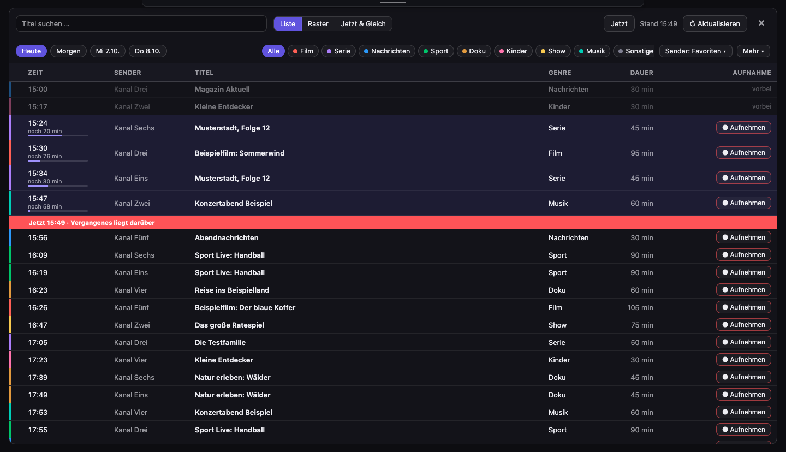

**Liste, Raster und Jetzt & Gleich:** Oben wechselst du mit dem Schalter **Liste | Raster | Jetzt & Gleich** die Darstellung; Senderauswahl, Tag, Zeitpunkt und Auswahl bleiben dabei erhalten. Womit sich der Programmführer öffnet, stellst du unter **Einstellungen → LiveTV → EPG → Startansicht des Programmführers** ein (Automatisch, Liste, Raster, Jetzt & Gleich); „Automatisch“ zeigt ab 900 Pixel Fensterbreite die Liste, in schmaleren Fenstern „Jetzt & Gleich“. Der Schalter im Programmführer gilt nur für die aktuelle Sitzung.
- **Liste** (Standard) – Alle Sendungen nach Startzeit mit Zeit, Sender, Titel, Genre und Dauer. Die Trennlinie „Jetzt“ markiert die aktuelle Uhrzeit, die laufende Sendung zeigt Fortschritt und „noch N min“, Vergangenes ist gedämpft, Nachtsendungen vor 05:00 gehören zum Vorabend (Badge „Nacht“).
- **Raster** – Sender als Zeilen, Sendungen als Blöcke auf einer Zeitachse mit roter Jetzt-Linie, Senderlogos und Zoom (3, 5 oder 8 px/min); Schnellsprünge zu 20:15 und 22:00.
- **Jetzt & Gleich** – Je Sender die laufende Sendung (mit Fortschritt), die nächste und die übernächste; ein Klick auf eine Sendung öffnet die Details, ein Klick auf den Sendernamen die Kanalansicht. Jede Zelle zeigt links ein kleines Vorschaubild; fehlt es, bleibt ein Platzhalter mit dem Anfangsbuchstaben. Die Anzeige aktualisiert sich alle 30 Sekunden und ist auch in schmalen Fenstern ohne Scrollen zur Seite nutzbar.
- **Tage** – Die Tabs (Gestern, Heute, Morgen, Wochentage) springen auf 05:00 des jeweiligen TV-Tags; **Jetzt** springt zur aktuellen Zeit. Das Genre erscheint als Spalte und Farbbalken.

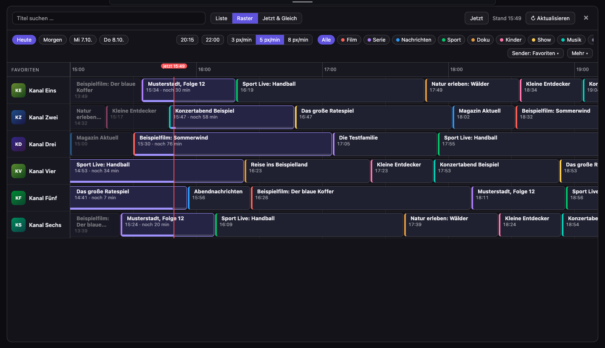

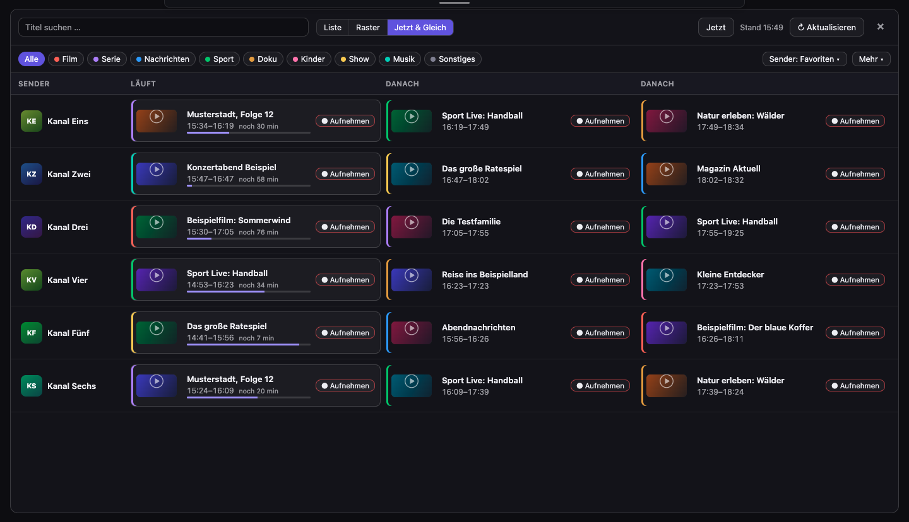

**Suche und Senderauswahl:** Das Suchfeld oben durchsucht die Titel der gewählten Sender (ab 2 Zeichen; Umlaute und Groß-/Kleinschreibung spielen keine Rolle). Die Treffer erscheinen als Liste mit Titel, Sender, Wochentag und Uhrzeit; ein Klick springt zum Termin und öffnet die Details, `Esc` leert und verlässt die Suche. Unter **Mehr ▾** lässt sich zusätzlich die Beschreibung durchsuchen und festlegen, ob Sender ohne EPG ausgeblendet werden (Standard). Über **Sender ▾** wählst du Favoriten (Standard), Alle Sender, eine Quelle oder eine Gruppe; die Auswahl gilt in Liste, Raster, Jetzt & Gleich und Suche und bleibt für die Sitzung erhalten.

**Genre-Filter:** Die Chips unter der Kopfzeile filtern nach Genre: Film, Serie, Nachrichten, Sport, Doku, Kinder, Show, Musik und Sonstiges. Du kannst mehrere Gruppen kombinieren; **Alle** oder ein Klick auf das ✕ am aktiven Chip hebt den Filter auf. In Liste und Jetzt & Gleich werden nicht passende Sendungen ausgeblendet, im Raster gedämpft; auch die Suche berücksichtigt den Filter. Sendungen ohne Genre-Angabe passen zu keiner aktiven Gruppe. Der Filter bleibt beim Moduswechsel und beim erneuten Öffnen des Programmführers erhalten, in der Kanalansicht sind die Chips ausgeblendet.

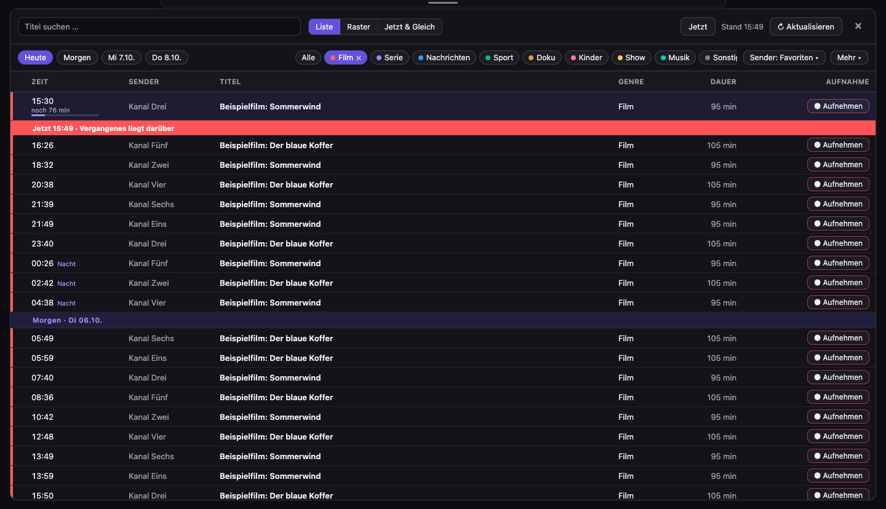

**Kanalansicht:** Klicke auf einen Sendernamen (Liste oder Raster) oder im Sendungsdetail auf **Alle Sendungen des Senders**, um alle Sendungen dieses Senders für 7 TV-Tage zu sehen. **← Alle Sender** oder `Esc` führt zurück, ohne dass Ansicht und Scrollposition verloren gehen. Mit **+ Weitere Tage** blendest du die Tage 8–14 ein, soweit der Cache reicht.

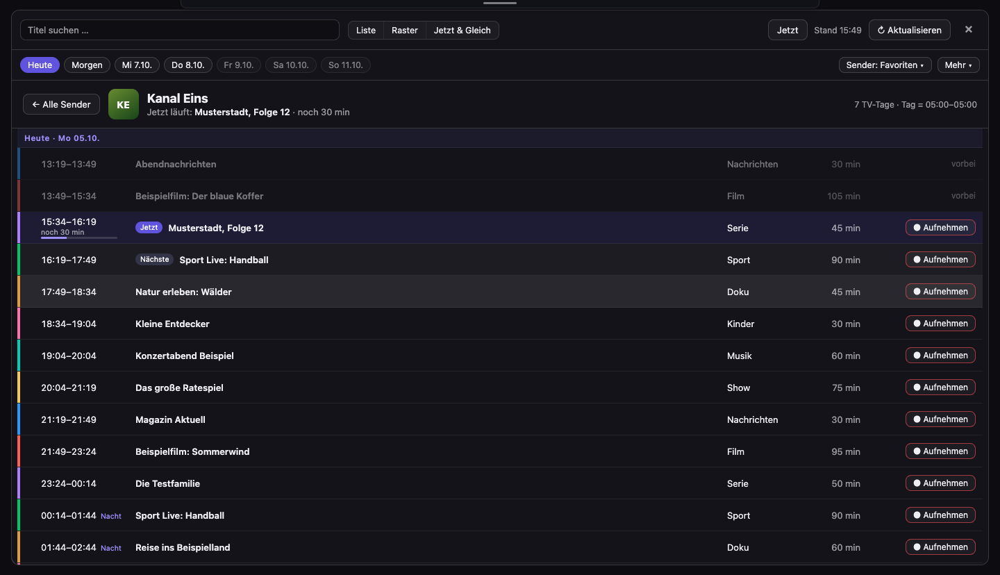

**Sendungsdetails:** Ein Klick auf eine Sendung öffnet die Details mit Beschreibung, einer Infozeile (Genre, Jahr, Dauer, Staffel und Folge), Besetzung (Regie und Mitwirkende), Poster, Untertitel und Altersfreigabe – jeweils nur, wenn die EPG-Quelle diese Angaben liefert. Der Abschnitt **Läuft auch** nennt bis zu 5 weitere Termine derselben Sendung; ein Klick springt dorthin. Außerdem gibt es **Sender öffnen** und **In Mediathek ansehen** (ARD/ZDF/arte, falls verfügbar). `Esc` schließt Details bzw. den Programmführer.

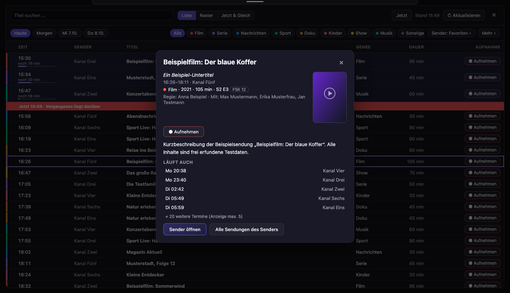

**Aufnehmen, Abbrechen, Stoppen:** Jede Sendung hat einen Knopf, der zum Zustand passt: **● Aufnehmen** (öffnet den Planungsdialog), **✕ Aufnahme abbrechen** (geplant, mit Rückfrage) oder **■ Aufnahme stoppen** (läuft, mit Rückfrage). Das Beenden einer laufenden Aufnahme meldet zuerst „wird beendet …“ und danach das Ergebnis. Aufnehmen lässt sich nur bei Sendungen, die noch nicht begonnen haben; laufende Sendungen nimmst du im TV-Player auf. Geplant wird bis 8 Tage im Voraus (darüber erscheint ein Hinweis).

**Marker:** Ein roter Punkt kennzeichnet Sendungen mit Aufnahme: statisch bei geplanter, pulsierend bei laufender Aufnahme. Die Marker aktualisieren sich live.

### Mediathek-Suche

Aus dem Programmführer kannst du Sendungen direkt in den Mediatheken suchen. Der Button "In Mediathek ansehen" öffnet den entsprechenden Dienst (ARD, ZDF oder ARTE) mit dem Sendungstitel als Suchbegriff.

### Verlauf

Klicke auf das Uhr-Icon in der Navigationsleiste oder drücke `Strg+H`, um den Verlauf zu öffnen. Er zeigt die zuletzt abgespielten Inhalte mit Titel, Dienst und Zeitstempel.

Ein Klick auf einen Eintrag springt direkt zum entsprechenden Dienst oder TV-Sender. Mit "Löschen" kannst du den gesamten Verlauf leeren.

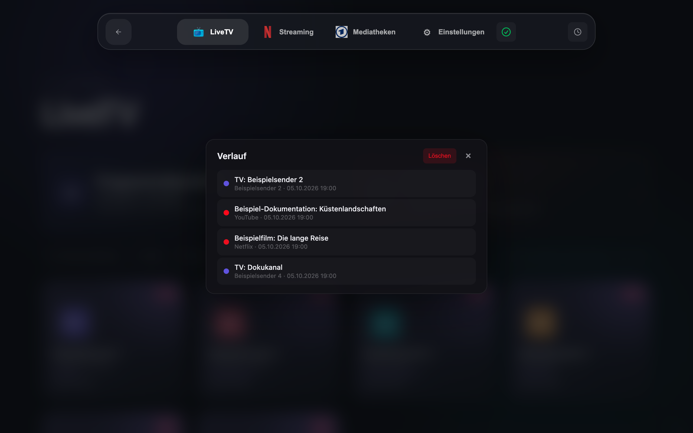

### Einstellungen

Klicke auf das Zahnrad-Icon in der Navigationsleiste, um die Einstellungen zu öffnen. Links wählst du eine Seite aus:

- **Allgemein** – Backup & Restore
- **LiveTV** – Quellen, Sender, EPG, Wiedergabe (TV-Modus) und Aufnahmen
- **Streaming** – Streaming-Dienste hinzufügen und entfernen
- **Radio** – Sender, Eigene Sender und Wiedergabe
- **Mediatheken** – Mediatheken hinzufügen und entfernen

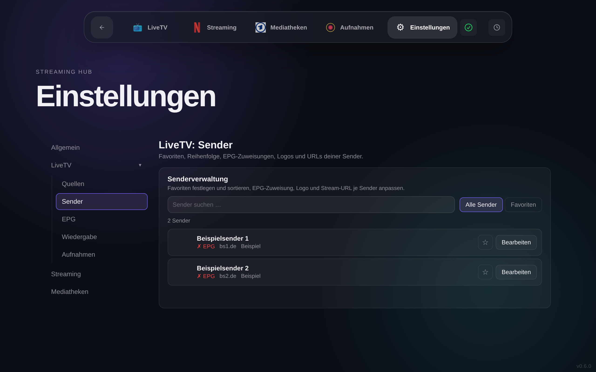

#### Backup & Restore
- **Backup erstellen** – Speichert Dienste, TV-Quellen, Radio und Verlauf als Datei
- **Backup einspielen** – Stellt ein vorheriges Backup wieder her

#### Dienste verwalten
Über **+** fügst du eigene Streaming-Dienste oder Mediatheken hinzu (Name, URL, Icon, Farbe); mit dem ×-Button entfernst du sie wieder.

#### TV-Modus
- **FreeTV** – LiveTV öffnet das Dashboard mit den Sendern aus deinen eigenen M3U-Quellen
- **MagentaTV** – TV-Button öffnet web.magentatv.de im Webview

### Tastaturkürzel

Drücke `?` für eine Übersicht aller Kürzel:

| Kürzel | Funktion |
|---|---|
| `Strg` + `Tab` | Nächster Dienst |
| `Strg` + `Umsch` + `Tab` | Vorheriger Dienst |
| `Alt` + `←` | Zurück zur vorherigen Ansicht |
| `Strg` + `H` | Verlauf anzeigen |
| `Strg` + `R` | Aufnahmen öffnen |
| `Strg` + `T` | Live-TV öffnen |
| `Strg` + `P` | Bild-in-Bild umschalten |
| `F11` | Vollbild umschalten |
| `?` | Kürzel-Übersicht |
| `Escape` | Modal / Overlay schließen |

**Im TV-Player zusätzlich:**

| Kürzel | Funktion |
|---|---|
| `Leertaste` / `K` | Play / Pause |
| `F` | Vollbild |
| `M` | Stumm schalten |
| `←` / `→` | 10s zurück / vor |
| `L` | Zur Live-Kante springen (DVR-Streams) |
| `R` | Aufnahme starten bzw. verwalten |
| `+` / `-` | Lautstärke hoch / runter |

### Auto-Update

Der Update-Button in der Navigationsleiste zeigt den Status:
- **Grüner Haken** – App ist aktuell
- **Roter Pfeil (pulsierend)** – Update verfügbar

Klicke auf den Button, um das Update zu starten. Die App lädt die neue Version herunter und startet automatisch neu. Laufende Aufnahmen solltest du vorher beenden.

Der Updater gilt für macOS (arm64 und x64) und für Linux-Installationen aus dem Release-Paket (x86_64). Je Version gibt es drei Releases: `vX.Y.Z` (macOS arm64), `vX.Y.Z-x64` (macOS Intel) und `vX.Y.Z-linux` (Linux x86_64); `npm run release:check` prüft, dass alle drei samt Asset vorhanden sind. Unter Linux wird das Installationsverzeichnis als Ganzes ausgetauscht (mit Rollback bei Fehlern); Einstellungen und Nutzerdaten liegen außerhalb und bleiben erhalten. Ein manuell gesetztes SUID-Bit an `chrome-sandbox` muss nach einem Update erneut gesetzt werden. Linux-Installationen aus dem Quellcode (`--source=git`) aktualisieren sich über `install.sh --source=git`, nicht in der App.

Für Tests (Entwickler): Mit `STREAMING_HUB_UPDATE_URL=http://127.0.0.1:PORT` fragt die App Releases bei einem lokalen Mock-Server statt bei GitHub ab. Der Override gilt nur bei ungepackter App oder lokalem http-Ziel, in der ausgelieferten App sonst nicht.

E2E-Läufe (`npm run test:e2e`) setzen `STREAMING_HUB_E2E_BACKGROUND=1`: Fenster erscheinen per `showInactive()` ohne Fokus, damit paralleles Arbeiten nicht gestört wird. Der Hook wirkt nur zusammen mit `STREAMING_HUB_USER_DATA`; Opt-out mit `E2E_FOREGROUND=1`. `pretest:e2e` stellt ffmpeg/ffprobe bereit (`scripts/prepare-e2e.js`) und baut `dist/`; native Fehlerdialoge werden im Testlauf unterdrückt und gezählt (`__streamingHubTest.suppressedDialogs`).

## Lizenz

MIT

Die Aufnahme-Funktion nutzt gebündelte ffmpeg/ffprobe-Programme als eigene Prozesse: macOS Apple Silicon ffmpeg 7.1 (osxexperts.net, GPL-Build), macOS Intel ffmpeg 7.0.2 (evermeet.cx, GPL-Build), Linux ffmpeg 7.0.2 (johnvansickle.com, GPL). ffmpeg steht unter LGPL/GPL, Quellcode und Lizenztexte: ffmpeg.org.
